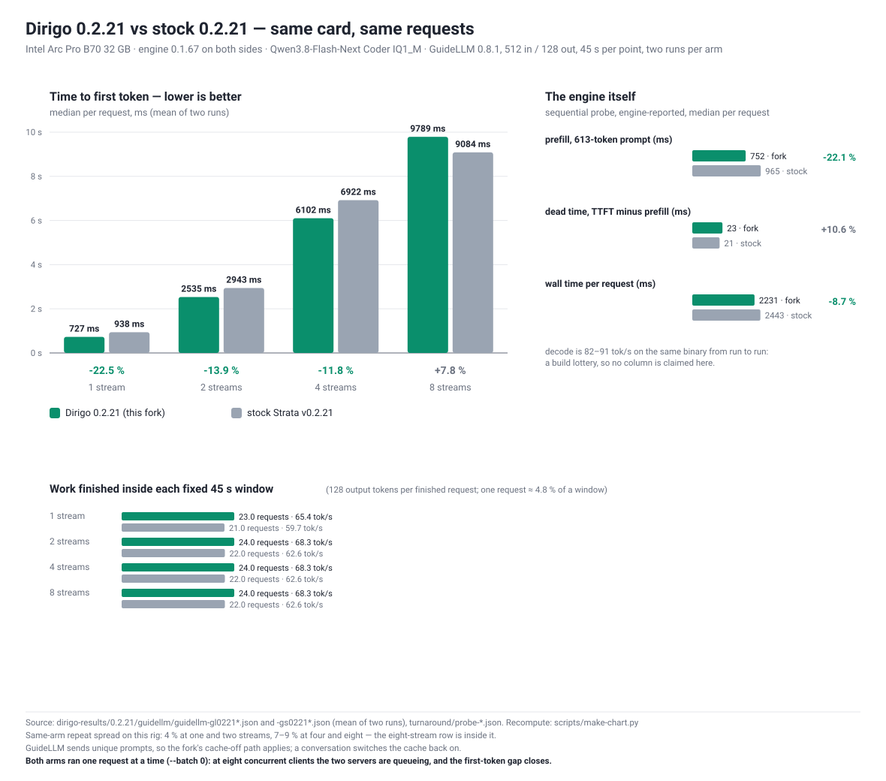

# Strata — Dirigo Agents' verified build

**Strata is a local AI engine.** It runs a very large language model on one ordinary PC by sharing the work
between the graphics card, the CPU, the RAM and the SSD — no account, no cloud. It speaks the OpenAI and
Anthropic APIs on `localhost`, so the coding tools you already use can talk to it.

This repository is **Dirigo Agents' fork** of [Niko1221/Strata](https://github.com/Niko1221/Strata) (MIT).
It is **source only**: no installers, no engine binaries, no model files. Upstream's own README is preserved at
[`docs/UPSTREAM-README.md`](docs/UPSTREAM-README.md).

<p align="center">
  
  <br><sub>Strata running a 24,576-expert model locally, on one graphics card.</sub>
</p>

The default branch, `dirigo/0.2.21-verified`, is one snapshot: upstream tag **v0.2.21** (engine **0.1.67**) plus this
fork's changes, verified on 2026-11-24 — with the measurements behind it kept in [`dirigo-results/`](dirigo-results/).
What was verified, and how: [`DIRIGO.md`](DIRIGO.md). Upstream reorganised the tree in v0.2.16 (`engine/` and
`terminal/`), so the build commands below are the new ones.

## Why this fork is faster than stock Strata

"Stock" here is **Niko1221's v0.2.21** — the upstream release — built from the same tag and run on the same card,
model, pack, config and request stream as this fork. Everything below is measured on both sides, not estimated.

**Reading a prompt is 22 % cheaper here, and the first token is 23 % sooner at one client.** The engine-level row needs
no server at all — one 613-token prompt, read once, median of two runs per tree: **752 ms** here against **965 ms** in
stock. On top of that the server puts the first token on screen sooner at every concurrency that has a real client:

**The first token arrives 22.5 % sooner at one stream** — 727 ms against stock's 938 ms — **14 % sooner at two** and
**12 % sooner at four**. At eight the two are level: the engine serves one request at a time, so beyond one user both
servers are mostly queueing.

> **The server gain shrinks as more clients share the box; the engine gain does not.** The first-token advantage runs
> 22.5 % at one client, 14 % at two and 12 % at four, and at eight there is nothing to quote — this run put stock 7.8 %
> ahead, the same-margin-of-noise row that two revisions of this fork have now landed on both sides of. The prefill gain
> is per request and constant: it is why a four-stream window finishes more answers here (24 against 22). If several
> people or agents will use the machine, size it for that with `--batch`/`--slots` ([batching](docs/BATCHING.md)).

<p align="center">
  
</p>

| streams | first token, this fork | stock v0.2.21 | arrives sooner by | read the other way: stock needs |
| --- | ---: | ---: | ---: | ---: |
| 1 | **727 ms** | 938 ms | **211 ms (22.5 %)** | 29.0 % longer |
| 2 | **2,535 ms** | 2,943 ms | **408 ms (13.9 %)** | 16.1 % longer |
| 4 | **6,102 ms** | 6,922 ms | **820 ms (11.8 %)** | 13.4 % longer |
| 8 | 9,789 ms | 9,084 ms | stock 705 ms ahead — a wash, not a result | a wash |

The engine-level row, which needs no server at all — one 613-token prompt, read once, median of two runs per tree:

| | this fork | stock v0.2.21 | difference |
| --- | ---: | ---: | ---: |
| prefill of a 613-token prompt | **752 ms** | 965 ms | **213 ms less (22.1 %)** |

The last two columns are one measurement read two ways: 727 ms is 22.5 % below 938 ms, and 938 ms is 29.0 % above
727 ms. "Arrives sooner" is the column to quote. In the same 45-second window the fork finishes 23 / 24 / 24 / 24
requests against 21 / 22 / 22 / 22 — 65.4 / 68.3 / 68.3 / 68.3 output tokens a second against 59.7 / 62.6 / 62.6 / 62.6,
so the fork also serves 9 % more tokens per window at every level.

**Which of those rows are you?** GuideLLM's "streams" are concurrent clients against one server.

- **One stream** is the ordinary case: one person at one keyboard, or one agent loop — ask, read the answer, ask again.
  That is where the 22.5 % applies, and it is most desktop use.
- **Two to four** is a few agents or tools sharing the box: an editor's assistant beside a terminal agent, or two
  people on one machine. 14 % and 12 % still apply.
- **Eight** is a queue: a batch job, an evaluation harness, a team of people. Both servers ran these tests at
  `--batch 0` — one request at a time — so eight clients wait their turn and the two lines meet. For several requests
  actually in flight, `--batch`/`--slots` (2–8 in the usual case; `--parallel` in the Terminal) is the setting, and the
  numbers would be a different experiment.

**Where the difference comes from.** The engine-side gap is the fork's own patches: at v0.2.17 it was 22.4 %, at
v0.2.21 it is 22.0 % against the same tag, so it is not an artefact of one release pair. Upstream has been improving
their prefill as well — stock's 613-token read went 993 ms → 965 ms between the tags — and ours moved with it and a
little further (770 → 752 ms), which is why this snapshot is the first fork build in four releases whose prompt reading
is back to the level production runs. In the **server**, a fresh prompt is the case the two handle differently: stock
opens the prompt cache and pays the pool work before it can emit a token, while the fork's router recognises a run of
unique prompts as one-shot traffic and serves it with the cache **off**, switching it back on the moment the traffic
looks like a conversation. That is why the first-token advantage is largest with requests arriving one at a time and
gone at eight streams where both servers are queue-bound.

**A control, so the mechanism is not taken on faith.** On the v0.2.17 build the same router was measured in both
positions: with `conv_route: shadow` — classify and log, never switch — it lands on the stock number, **963 ms** at one
stream (`off`: 958 ms), and with `conv_route: on` it lands on **739 ms**. Same build, same card, same workload; the
switch is what moves the first token ([the pair](dirigo-results/0.2.17/), and [the report](dirigo-results/0.2.17/)). The
two arms of the comparison above also ran one config file each, identical apart from paths, and the same model file for
the 28.8 GB lookup table.

**Reproduce it.** `dirigo-results/0.2.21/scripts/strata-gl-arms.sh` runs an arm (label, tree, config) and
`scripts/strata-turnaround-run.sh` runs the sequential engine probe; [the report folder](dirigo-results/0.2.21/)
carries the per-level JSON for three arms, the chart, and `make-chart.py`, which recomputes every figure on this page
from those files. All arms: 0 errored requests.

**What it does not show.** A faster *decode*: 82–91 tokens a second measured across runs of the same binary — that
spread is a build lottery and the fork claims nothing from it. A win on conversations, where the cache comes back on and
the two converge. Anything about multi-slot serving: the tests ran `--batch 0`, one request at a time. A throughput or
latency win at the highest concurrency: the eight-stream row moves with the noise floor in both directions.

**What the engine both of us run is doing.** Underneath the server, the speed is stock's: only the experts a word
needs are computed (the card and the CPU working at the same time), prompts are read in 8,192-token pieces and reused
on a follow-up, and the draft layer guesses up to three tokens for one-pass verification. None of that is ours, and
none of it is changed by the fork — [how it works](docs/HOW_IT_WORKS.md).

> **Measured on:** Intel Arc Pro B70 32 GB, Qwen3.8-Flash-Next Coder IQ1_M, engine 0.1.67 on both sides, 2026-11-24.
> Two GuideLLM arms per side, interleaved in one session; same-arm repeat spread in this rig is 4 % at one and two
> streams and 7–9 % at four and eight, so the 22.5 %, 14 % and 12 % first-token gaps sit outside it while the
> eight-stream row does not. Errors: 0 in every arm. Full report, raw JSON and the scripts that recompute every figure:
> [`dirigo-results/0.2.21/`](dirigo-results/0.2.21/).

> **Never used Strata before?** Start with [Getting started](docs/GETTING-STARTED.md) — it walks from "what is
> this" to your first answer, and explains every word Strata uses in [plain language](docs/GLOSSARY.md).
>
> **Just want to run Strata, not build it?** Use the stock release instead — one line in the terminal and no compiler:
> [Download the release](https://github.com/Niko1221/Strata/releases/latest) · [install guide](docs/INSTALL.md).

## Start here

| I want to… | Go to | Time |
| --- | --- | --- |
| Run Strata on my own PC | [Install (stock release)](docs/INSTALL.md) — installer, or one line in the terminal | 10 min + model download |
| Reproduce the build this fork verified | [Quick start](#quick-start-build-this-snapshot) below · [evidence](DIRIGO.md) | 30–60 min of compiling |
| Connect Claude Code, Codex, OpenCode, Hermes… | `strata connect`, or [tool connections](docs/TERMINAL_LAUNCH.md#connect-your-apps-strata-connect) | 5 min |
| Check my hardware before downloading anything | [What you need](#what-you-need) · [which model fits](docs/MODELS.md#pick-by-memory) | 5 min |
| Understand the engine | [How it works](docs/HOW_IT_WORKS.md) · [technical reference](docs/DETAILS.md) | — |
| Read the evidence for the numbers | [`DIRIGO.md`](DIRIGO.md) · [`dirigo-results/`](dirigo-results/) | — |
| See how it compares to stock 0.2.21 | [Measured side by side](#why-this-fork-is-faster-than-stock-strata) | — |
| All guides, page by page | [Documentation index](docs/README.md) | — |

## What you need

Strata is not a small-model tool. The smallest recommended Qwen3.8-Flash-Next pack needs about **37.6 GB of
memory (RAM plus VRAM)**; the coding-only pack runs in about 32 GB. Unified memory (Apple Silicon, Strix Halo)
counts once. Check [which model fits](docs/MODELS.md#pick-by-memory) before you download tens of gigabytes.

| | Requirement |
| --- | --- |
| Graphics card | NVIDIA RTX 20/30/40/50 · AMD Radeon RX 7000/9000 and AI PRO R9700 (RX 6000 experimental) · Intel Arc on Linux · Apple Silicon |
| Memory | 38–55 GB of RAM + VRAM for the Qwen3.8-Flash-Next packs (37.6 GB for the smallest), with room left for the OS; 46–64 GB of system RAM plus a 12 GB card for DeepSeek V4.1-Flash |
| Disk | SSD: **66–84 GB** for Qwen3.8-Flash-Next — the pack plus the model's 28.8 GB lookup table — and 239–274 GB for DeepSeek V4.1-Flash |
| To build from source | Python 3, CMake 3.24+, Ninja, a C++20 compiler, and your GPU's toolkit (CUDA, ROCm, oneAPI or Xcode) |

The 28.8 GB in that disk figure is the model's lookup table, not the engine's: it is the publisher's second file,
read from the SSD a few rows at a time instead of being held in memory. It belongs to every pack of this model, stock
or fork alike — [what it is and where the size comes from](docs/GLOSSARY.md#the-model).

The card-specific details are in [NVIDIA](docs/INSTALL.md#what-you-need), [AMD](docs/AMD_HIP.md),
[Intel Arc](docs/INTEL_ARC.md), [Mac](docs/MAC.md), [multiple GPUs](docs/MULTI_GPU.md).

## Quick start: build this snapshot

This is the build the branch was verified with: Intel Arc, SYCL AOT `bmg-g31`, Intel oneAPI 2026.2. AMD and
NVIDIA build from the same sources with their own guides below.

```sh
# 1. source (the default branch is the verified snapshot)
git clone --branch dirigo/0.2.21-verified https://github.com/rwkeyes/Strata.git
cd Strata

# 2. Python side
python3 -m venv .venv && . .venv/bin/activate && pip install -r requirements.txt

# 3. build — needs oneAPI's icpx and oneMKL on PATH: source /opt/intel/oneapi/setvars.sh
cmake -S engine/sycl -B build-sycl-aot -DSTRATA_SYCL_AOT=bmg-g31   # v0.2.16 moved the SYCL project under engine/
cmake --build build-sycl-aot --target strata -j"$(nproc)"

# 4. prove what you built before going further
./build-sycl-aot/strata --version          # must print: strata 0.1.67
```

The engine reads a **pack** (a prepared model folder) plus the model's GGUF shards. Build the pack from the
GGUF files you downloaded, once per model:

```sh
python tools/iq_pack.py \
  --gguf /path/to/Qwen3.8-Flash-Next-GSQ-RCO-IQ3_XXS-00001-of-00002.gguf \
  --out packs/iq3xxs
```

Then serve. These are the settings the measured service ran with — replace the paths, and keep
`data/expert-profile*.bin` where the binary can find it. The profile is matched to the model's **expert count**, not its
quantization: the full model (IQ2/IQ3/Q2 packs, 48×512) takes `data/expert-profile.bin`; the pruned *Coder* model
(48×256) takes `data/expert-profile-coder.bin`. The wrong one is refused at start with
`it is a profile for a different model`:

```sh
./build-sycl-aot/strata --serve \
  --pack packs/iq3xxs --native <shard-1.gguf> --ple-gguf <shard-2.gguf> \
  --expert-profile data/expert-profile.bin --expert-cache auto --stream-experts --prefill auto \
  --prompt-cache 6 --prompt-cache-every 4096 --batch 0 --spec 6 --spec-min-p 0.5 \
  --mtp <draft> --mtp-draft-vocab data/draft_vocab_en.bin --mtp-window 8192 \
  --max-context 131072 --kv int8 --kv-resident 32768 --vram-reserve-mib 700
```

`--serve` is the engine's own token protocol. For a browser or an OpenAI-compatible API, run the bundled
server with those arguments in its config (`args`), and check it answers:

```sh
.venv/bin/python -m serve.server --engine strata --config strata.json --port 8080
curl -s http://127.0.0.1:8080/v1/models
```

Other builds: [AMD / HIP](docs/AMD_HIP.md#build) · [NVIDIA / CUDA](docs/SOURCE_INSTALL.md#build-from-git-on-linux-to-try-a-pull-request-or-change-the-code) ·
[Mac / Metal](docs/MAC.md) · [the guided `./setup.sh` route](docs/SOURCE_INSTALL.md).

## Quick start: stock release

If you want Strata running rather than built, the released app and terminal do the engine choice, download
and model preparation for you:

```sh
# Linux / Mac
curl -fsSL https://github.com/Niko1221/Strata/releases/latest/download/install.sh -o install.sh && sh install.sh
strata launch
```

```powershell
# Windows PowerShell, then open a new terminal
irm https://github.com/Niko1221/Strata/releases/latest/download/install.ps1 | iex
```

`strata launch --plan` prints what would be downloaded and how much memory it needs, and changes nothing.
[Full install guide](docs/INSTALL.md) · [Terminal launch](docs/TERMINAL_LAUNCH.md).

## Words you will meet

| Word | Plain meaning |
| --- | --- |
| pack | a prepared model folder the engine reads |
| shard | one part of a model file split across several downloads |
| quantization (Q2_0, IQ3_XXS, IQ1_M) | how much the model was compressed — smaller is faster and lighter, larger is better |
| expert | one small specialist network inside the model; only a few are needed per word |
| PLE table | the big lookup table Strata reads from your SSD instead of holding in memory |
| KV cache | what the model remembers about the conversation; costs memory per token of context |
| slot | one conversation being served at a time (the engine serves one at a time by design) |
| prefill / decode | reading your prompt / writing the answer |
| TTFT | time to first token — how long before the answer starts |
| spec / MTP | the helper that guesses the next words so the big model can check several at once |
| TUNE | the fork's channel for changing engine settings between requests, without a restart |

Full list, including the fork-specific terms: [Glossary](docs/GLOSSARY.md).

## If your first run fails

| Symptom | What to do |
| --- | --- |
| `strata` is not found | Open a new terminal; on Linux/Mac add `~/.local/bin` to `PATH` |
| "Couldn't find an engine for this computer" | `strata update`, then `strata doctor --live` ([Troubleshooting](docs/TROUBLESHOOTING.md)) |
| Build stops at `icpx: not found` | `source /opt/intel/oneapi/setvars.sh` before `cmake` |
| Engine exits before it is ready, after a source build | The expert profile is missing — `data/expert-profile.bin` must be beside the binary's working directory |
| It used the wrong graphics card | `strata-device --list-devices`; pick one with `--device` or `ROCR_VISIBLE_DEVICES` / `CUDA_VISIBLE_DEVICES` |
| Loads, then runs out of memory | Smaller pack, lower `--max-context`, or lower `--kv-resident` |
| Very slow first answer | First start warms the file cache; measure the second request |

More: [Troubleshooting](docs/TROUBLESHOOTING.md) · [engine errors](docs/DETAILS.md#troubleshooting).

## What this fork changes

The engine, kernels and model format are upstream's. This fork adds server-level behaviour and one engine change;
with none of them enabled the server behaves as stock.

| Change | What it does |
| --- | --- |
| conversation-cache routing | turns the prompt cache off after **four** single-shot prompts in a row; one conversational turn switches it back on. Worth −12…−22 % first-token time at 1–4 clients and nothing at 8, and nothing on a conversation — and a threshold of 1 costs 1.9 s per conversation ([why](docs/PERF-NEXT.md#7-mixed-traffic-why-batch_after-stays-at-4)) |
| thinking policy | skips the scratchpad for short, factual asks; keeps it when the answer needs work |
| retune between requests | change engine settings on a live server — no restart, no reload |
| per-request draft depth | a client can set its own speculation depth for one request |

### Around drafting: the same drafter, more control

Both versions run the model's MTP draft layer; nothing in the carry replaces it. What the fork adds is how it can be
set — and `spec_min_p` per request is upstream's, not ours:

| setting | stock v0.2.21 | this fork |
| --- | --- | --- |
| draft depth | `--spec` at startup, for every request | also `spec=N` per request, clamped by the engine to 2…the startup value |
| prompt lookup | `--suffix-draft` at startup | also `lookup=0\|1` per request |
| draft confidence | `spec_min_p` per request via `strata_tune` | the same, and changeable globally on a live server |
| window policy | — | `spec_window`: serve some traffic at a lower depth (0 in the measured config) |

None of it was switched on for the speed numbers above: `spec_window` was 0, and GuideLLM sends no `strata_tune`.

### Two measured differences that are not speed

- **Short answers.** Asked for a date inside a 24-token budget ("Invoice INV-7 dated 9 June 2024 → ISO date"), stock
  spends all 24 tokens on reasoning and returns an empty string; the fork returns `2024-06-09` with zero reasoning
  characters.
- **A green suite, and one kernel battery both trees fail the same way.** Both trees pass the server suite (this fork
  2,106 tests, stock 2,081; 26 skipped in each). The kernel battery is 97 tests: 78 pass here against 76 there — the 19
  shared failures are upstream's new `native_expert_parity_new_*` CPU checks, and the fork's carry closes the two stock
  still fails on top of them (`ple_parity`, `qsa_prompt_attn_parity`).

### What it is worth, measured

The numbers are above, in [Why this fork is faster than stock Strata](#why-this-fork-is-faster-than-stock-strata):
first token 24 % / 10 % / 9 % sooner at one / two / four streams, and engine prefill 22 % lower at every concurrency.
Full report, raw JSON, the chart and the scripts that recompute every figure:
[`dirigo-results/0.2.21/`](dirigo-results/0.2.21/).

The parts that belong upstream are open as separate branches listed in [`DIRIGO.md`](DIRIGO.md).

## Repository map

| Path | What lives there |
| --- | --- |
| `engine/` | the engine: `engine/sycl/` (Intel Arc), `engine/src/`, `engine/include/` (CUDA and the shared C++), `engine/metal/` (Apple Silicon) |
| `terminal/` | the OpenAI / Anthropic compatible server (`terminal/serve/`), model preparation, monitoring, the `strata` terminal command, and the measurement tools |
| `app/` | the desktop app |
| `bench/` | benchmark protocol and community results |
| `docs/` | all guides — [index](docs/README.md) |
| `dirigo-results/` | this fork's measurements: the 0.2.21 fork-vs-stock report, chart and raw JSON, the earlier 0.2.12/0.2.13/0.2.15 evidence, the carry patches |

## Licence

MIT — upstream Strata plus the Dirigo changes; see [`LICENSE`](LICENSE). Model files are not part of this
repository and carry their own licences.

The translated READMEs (`README.de.md`, `README.es.md`, `README.fr.md`, `README.ja.md`, `README.pl.md`,
`README.pt-BR.md`, `README.zh-CN.md`) are upstream's and describe **stock** Strata, not this fork.
