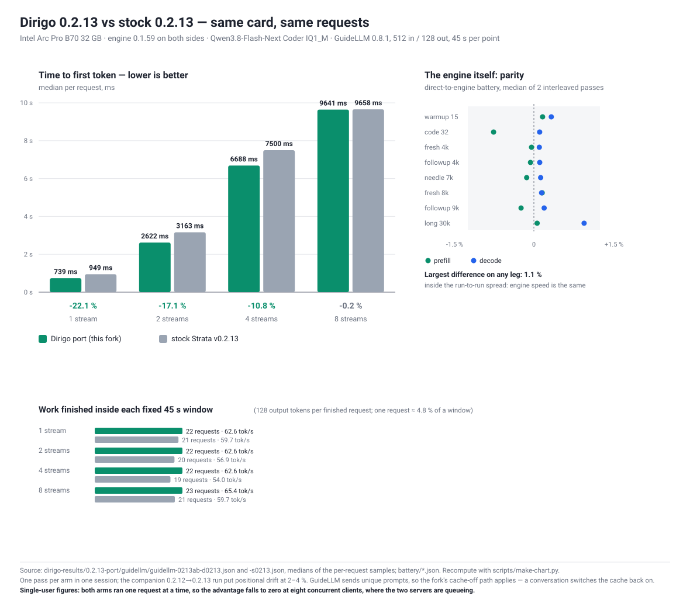

# Dirigo 0.2.13 port vs stock 0.2.13 — same battery, Arc Pro B70

**Date:** 2026-11-09 · numbers re-derived from the raw JSON on 2026-11-13 · **Operator:** rwkeyes (Dirigo Agents LLC) ·
**Report kind:** community benchmark, fork-vs-stock

This is not a stock benchmark run: it measures **the Dirigo port of 0.2.13 against the tagged v0.2.13 tree**, with
the same tests on both sides. It answers two questions on one rig: did carrying the fork onto 0.2.13 cost anything on
the engine, and what is the fork's server-side carry worth on this hardware.

Every figure in the chart is recomputed from the JSON files in this folder by `scripts/make-chart.py`.

## Headline

| | Dirigo port | stock v0.2.13 | first token arrives sooner by | same measurement, other way round |
| --- | ---: | ---: | ---: | ---: |
| Time to first token, 1 stream (median) | **739 ms** | 949 ms | **210 ms (22.1 %)** | stock needs 28.4 % longer |
| Time to first token, 2 streams | **2,622 ms** | 3,163 ms | **541 ms (17.1 %)** | stock needs 20.6 % longer |
| Time to first token, 4 streams | **6,688 ms** | 7,500 ms | **812 ms (10.8 %)** | stock needs 12.1 % longer |
| Time to first token, 8 streams | 9,641 ms | 9,659 ms | 18 ms — equal | equal |
| Requests finished in a fixed 45 s window, 1 / 2 / 4 / 8 streams | 22 / 22 / 22 / 23 | 21 / 20 / 19 / 21 | +1 / +2 / +3 / +2 |
| Prefill and decode, direct to the engine, 8 legs | — | — | **parity, largest gap 1.1 %** |
| Unit suite | **1,537 OK** | 1,512, 1 failure | — |
| 24-token extraction | **answers** | truncates | — |

Read it as: **the engine is the same speed; the server answers sooner.** On a stream of unique prompts the fork's
router serves with the prompt cache off, so there is no pool work between the request and the first token. A
conversation switches the cache back on, which is what stock always does.

## Hardware and software

| | |
| --- | --- |
| GPU | Intel Arc Pro B70 32 GB (Battlemage G31, `8086:e223`), AOT target `bmg-g31` |
| Display | AMD Raphael iGPU — the Arc is compute-only |
| CPU | AMD Ryzen 7 7700X (8 cores) |
| Kernel | 7.0.0-42-generic |
| Toolkit | oneAPI compiler 2026.2 |
| Model | `qwen3.8-flash-next-coder-iq1_m` (IQ1_M + mine expert pack) |
| Engine | **0.1.59** on both sides, ggml pin `3cf0325` |

Both trees were built with the same script, the same flags and the same pinned ggml:

| tree | ref | commits over tag | engine binary |
|---|---|---|---|
| dirigo | `release/0.2.13` @ `3512b4cc` | 2 (38 files, +5,062/−264) | 99,889,376 B (`a44a41938f2aeda0…`) |
| stock | tag `v0.2.13` — annotated tag object `fb57f747`, commit `d2f0964` | — | 99,897,992 B (`7b5439980466a569…`) |

The three commits after `3512b4cc` on the `port/0.2.13` branch add this report and nothing else: `git diff
--name-only 3512b4cc origin/port/0.2.13` lists files under `bench/` only.

Only one engine ran at a time, with the card to itself. Both server configs were identical apart from paths: same
pack, same `args`, `conv_route: "on"`, `thinking_policy: "on"`, and the two `data/expert-profile-mine.bin` files are
byte-identical (`sha256 7bd9a9c35d65b68b…`). The stock server ignores the fork's lever keys rather than erroring on
them. Full details in `provenance.json`.

## 1. Unit suites

| | dirigo | stock |
|---|---|---|
| tests | **1,537** | 1,512 |
| result | **`OK (skipped=17)`** | `FAILED (failures=1, skipped=17)` |
| failure | — | `test_hip_ordinal`: `'0,1' != '1,0'` |

Both were run with `python -m unittest discover -s serve -p 'test_*.py'` (logs in `suites/`).

The stock failure is a test that reads the host: when the machine has an integrated Radeon, `HIP_IGPU_ARCHS` makes
`ordered_gpus()` return `0,1` where the test expects `1,0`. It is fixed in the dirigo tree through the existing seam
(stub the topology probes, pin the reorder) — upstream PR
[Niko1221/Strata#5602](https://github.com/Niko1221/Strata/pull/5602). The 25-test gap is the fork's own test files
(`test_spec_window`, `test_thinking_policy`, `test_conv_router`, `test_tune`, …): 12 files, +2,579 lines under `serve/`.

## 2. Behaviour probes

| probe | dirigo | stock |
|---|---|---|
| minefield, 5 traps (capital, decimal, nonempty, count_r, reverse) | **5/5** | 5/5 |
| 24-token extraction — "Invoice INV-7 dated 9 June 2024 → ISO date" | **`2024-06-09`**, 0 reasoning chars | **`''`**, `finish_reason: length` |
| `GET /v1/tuning` | 200 | 404 |
| `POST /v1/tune {"spec_min_p": 0.5}` | 200 `{"applied": {"spec_min_p": 0.5}, "refused": []}` | 404 |
| needle at 7,855 tokens, marker `ZQ-7731-KX` | 2/2 correct | 2/2 correct |
| 165,779-token request | 400, `request exceeds the context window … requests are never truncated` | 400, identical wording |
| code leg (list reversal) | complete, closing fence, `finish: stop` | complete, closing fence, `finish: stop` |

The extraction row carries the user-visible weight: given 24 tokens, stock spends all of them on reasoning and
returns nothing, while the fork's short-answer policy answers directly. Same engine, same weights, same request.

## 3. Prefill / decode battery

Medians of two interleaved passes per arm (order dirigo, stock, stock, dirigo) so drift lands on both. Recomputed
from the exact medians in `battery/*.json`:

| leg | prompt tokens | dirigo prefill / decode (tok/s) | stock prefill / decode | Δ prefill | Δ decode |
|---|---|---|---|---|---|
| warmup | 15 | 76.0 / 25.4 | 75.8 / 25.2 | +0.2 % | +0.4 % |
| code | 32 | 59.6 / 114.8 | 60.1 / 114.7 | −0.9 % | +0.1 % |
| fresh | 4,210 | 1332.8 / 81.2 | 1333.6 / 81.0 | −0.1 % | +0.1 % |
| fresh | 8,830 | 1411.9 / 85.5 | 1409.2 / 85.4 | +0.2 % | +0.2 % |
| follow-up | 4,451 | 326.9 / 75.8 | 327.1 / 75.7 | −0.1 % | +0.1 % |
| follow-up | 9,071 | 274.4 / 85.9 | 275.2 / 85.7 | −0.3 % | +0.2 % |
| needle | 7,855 | 1435.6 / 97.5 | 1438.0 / 97.3 | −0.2 % | +0.2 % |
| long | 30,178 | 1819.4 / 48.8 | 1818.0 / 48.2 | +0.1 % | +1.1 % |

Δ is the fork relative to stock. Engine throughput is the same on both sides within 1.1 % on every leg. That is the
expected result — the carry's engine change is the `TUNE` control line, which is not on the measured path — and it is
what lets this report claim the fork costs nothing to run.

## 4. GuideLLM

GuideLLM 0.8.1, `synthetic_text` 512 in / 128 out, concurrent profile `streams 1,2,4,8`, 45 s per point, dirigo then
stock in the same session.

| streams | TTFT dirigo | TTFT stock | Δ TTFT | requests finished dirigo / stock | output tok/s in window dirigo / stock | cancelled at 45 s |
|---|---|---|---|---|---|---|
| 1 | **739 ms** | 949 ms | **−22.1 %** | 22 / 21 | 62.6 / 59.7 | 4 / 4 |
| 2 | **2,622 ms** | 3,163 ms | **−17.1 %** | 22 / 20 | 62.6 / 56.9 | 5 / 5 |
| 4 | **6,688 ms** | 7,500 ms | **−10.8 %** | 22 / 19 | 62.6 / 54.0 | 8 / 8 |
| 8 | 9,641 ms | 9,659 ms | −0.2 % | 23 / 21 | 65.4 / 59.7 | 14 / 14 |

Δ TTFT is the fork relative to stock; lower is better. Errored requests: **0 in both arms** at every level. Three
reading notes, because the columns are easy to misread:

- **"output tok/s in window" is finished work, not a token-rate measurement.** Every finished request produced
  exactly 128 output tokens (the cap), so the figure is `requests × 128 / 45 s`. One request is 4.8 % of a window:
  the 1-stream difference (+4.9 %) sits at that granularity limit, the 2–4-stream differences (+10.0 %, +15.9 %) do not.
- **The cancelled count is identical on both arms** (4/5/8/14). Those are requests still streaming when the 45 s cap
  closed the window, not failures.
- **8 streams shows no TTFT gap** because queueing dominates there: both servers hold one request at a time, so the
  time to first token is mostly waiting for the queue.

Why the gap exists: both configs carry `conv_route: "on"`, and the stock server ignores that key. A run of unique
prompts is the traffic the fork's router classifies as one-shot and serves with the prompt cache **off**; stock keeps
the cache on and pays pool work before the first token. The same switch measured on 0.2.12 put `conv_route: on` at
727 ms against 934 ms for `shadow` (which never switches the cache off) at one stream.

Caveat carried honestly: one pass per arm in one session. The companion 0.2.12→0.2.13 run put positional drift at
2–4 % in the same rig, so the 1–4-stream TTFT gaps (10.8–22.1 %) are larger than the drift and the 1-stream request
count is not.

## 5. Determinism (why the fork did not move to 0.2.13's headline fix)

v0.2.13's notes advertise that Intel Arc now returns the same answer for the same prompt (their bf16 prompt products
moved off oneMKL onto a fixed-order kernel: "50 of 50 identical on an A750, against 3–5 different in 5 runs before").
On this card that was **already true on 0.2.12**: with greedy decoding, three prompts repeated 10× and a 4,200-token
prompt repeated 6× gave **1 distinct answer each** on both engines (`determinism/`). So the release's headline Arc win
is not reproducible here, and this report does not claim it.

## Corrections after re-deriving the numbers (2026-11-13)

The first version of this report was written from a generator's summary. Recomputing everything from
`guidellm/*.json` and `battery/*.json` reproduced the battery table and found three things to fix:

1. **"errored 22 / 21" was wrong.** Those are the *successful* request counts. The scheduler state says
   `errored_requests: 0` at every level in both arms, and `cancelled_requests: 4/5/8/14` — identical on both sides.
   The column now says what it is.
2. **`tok/s` was the mean of per-iteration samples**, not throughput: 62.58 at 1, 2 and 4 streams is the same decode
   loop averaged three times, not three measurements that agree. The table now shows finished requests and the tokens
   they carry in the fixed window, with the 4.8 % granularity stated.
3. **The stock ref was labelled "tag commit `fb57f747`".** That is the annotated **tag object**; the commit it points
   at is `d2f0964`. Both are now given.

Two more numbers were corrected in passing: the battery deltas are now computed from the exact medians rather than
from the rounded cells (warmup decode +0.4 % not +0.8 %, code prefill −0.9 % not −0.8 %, long decode +1.1 % not
+1.2 %).

One claim is **not** supported by anything shipped here, so it is gone: that every window verified "12,288 of 12,288
expert slots pre-filled and 0 experts over PCIe". The operator's window launcher printed it; no log excerpt was kept,
so it cannot be checked from this folder.

## What this does and does not show

Shows: the fork's 0.2.13 tree builds and passes its suite where the stock tree has one host-dependent failure; at
identical engine throughput it answers short requests that stock truncates, exposes two runtime levers stock does not
have, and is **10.8–22.1 % sooner to first token at 1–4 concurrent streams** on this card, with the same settings and
the same model.

Does not show: anything about other GPUs or other engines; a full statistical treatment of the GuideLLM gap (one pass
per arm); any benefit from 0.2.13's bf16 determinism change, which this hardware did not need; a speed win for
conversational traffic, where the fork turns the cache back on and behaves like stock; or a speed win as clients are
added — the advantage falls from 22 % to 17 % to 11 % at one, two and four concurrent clients and is gone at eight,
because every arm here ran one request at a time (`--batch 0`).

## Reproducing

`scripts/` holds the harnesses used, unmodified apart from path placeholders:

- `strata-0213-ab.sh` — the four-window battery (`bench_prefill` + longprobe per window, order d s s d)
- `strata-guidellm-0213-ab.sh` — the GuideLLM two-arm run
- `strata-determinism-probe.py` — the repeated-greedy-prompt probe
- `make-chart.py` — recomputes every figure in `chart.svg` from this folder's JSON: `BENCH=. python3 scripts/make-chart.py`

Paths that were absolute on the operator's box appear as `<data>` and `<home>`. The engine logs and configs are not
shipped: a config names the pack and the launch flags, and the pack is a build artifact.
